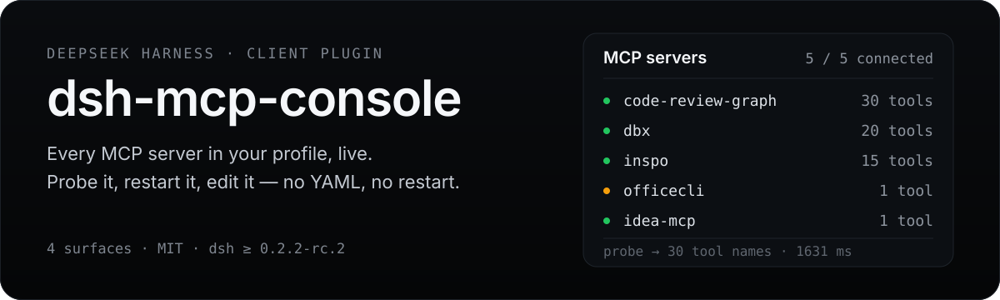
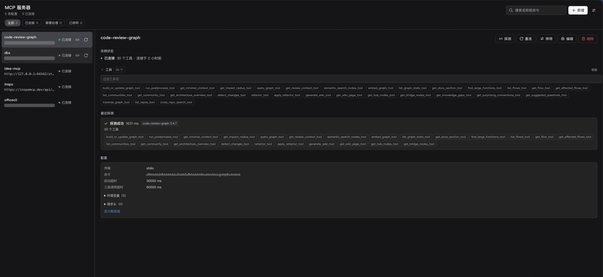
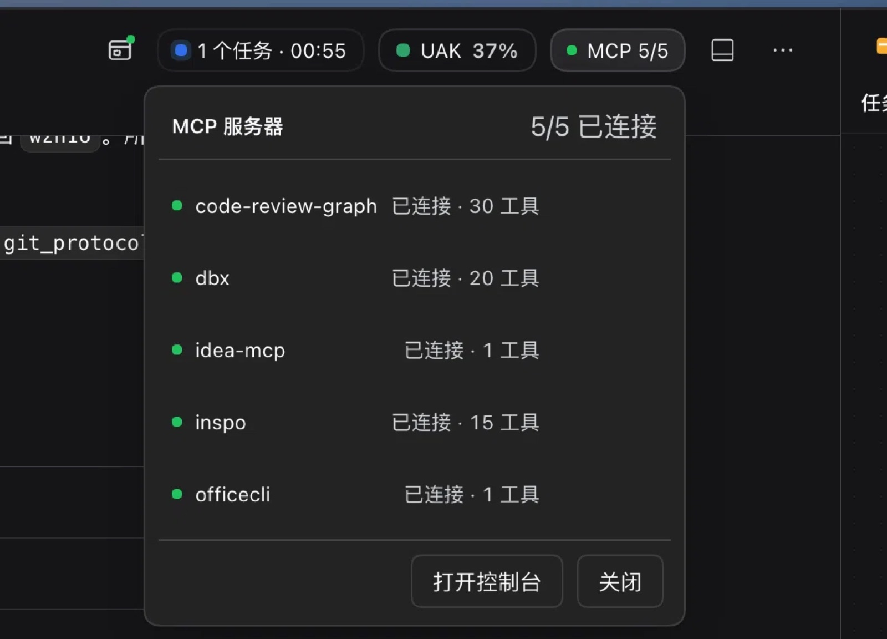
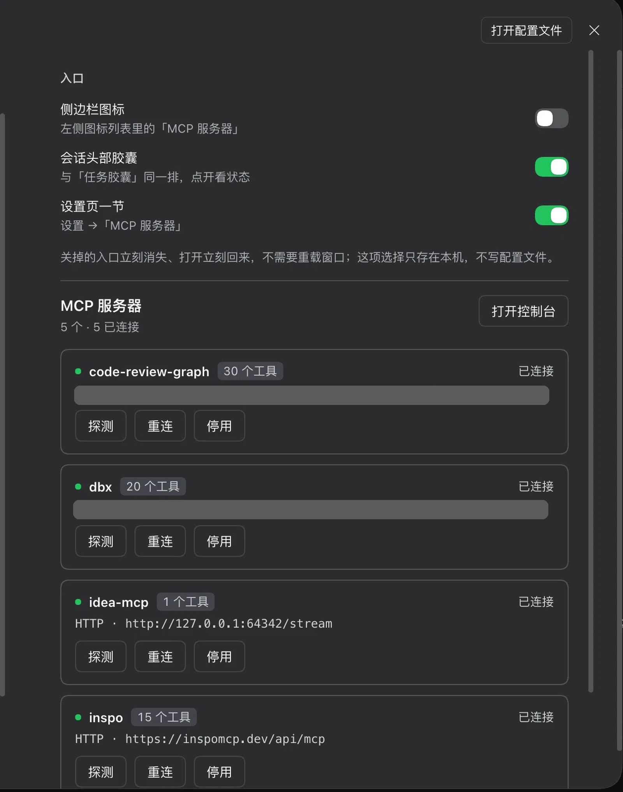
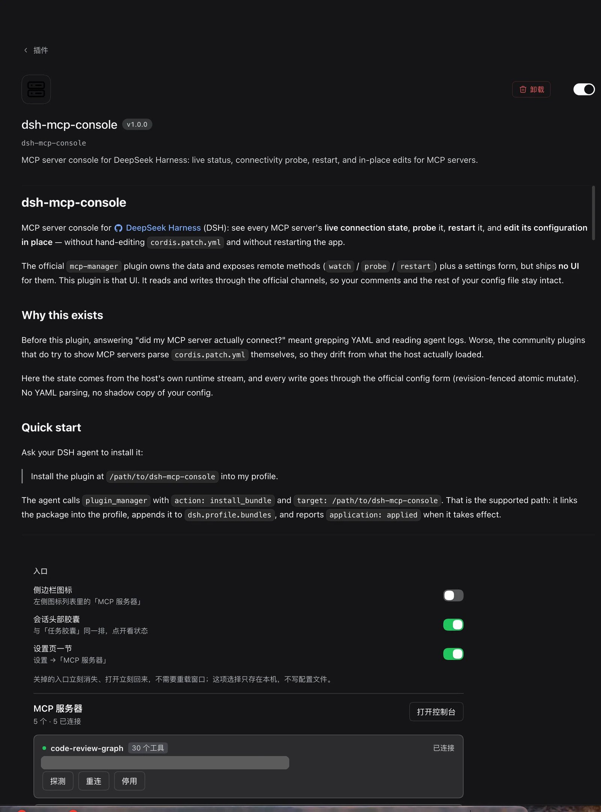
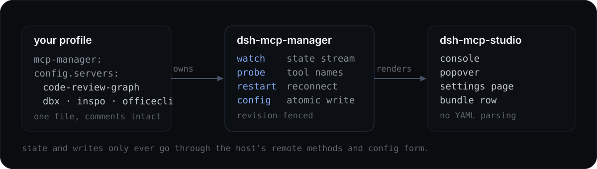

**dsh-mcp-studio** is the missing UI for DeepSeek Harness's official `mcp-manager` plugin: see each
MCP server's **live connection state**, **probe** it for its tool list, **restart** it, and **edit it in
place** — without hand-editing `cordis.patch.yml` and without restarting the app.

Everything it shows comes from the host's own runtime stream, and every write goes through the official
config form (revision-fenced atomic mutate). No YAML parsing, no shadow copy of your config, your
comments stay where they are.

## The console



Server list on the left with state, command and tool count; detail pane on the right with the live
instance state, an expandable tool list, the last probe result, and the resolved configuration. Probe,
restart, enable/disable, edit and delete are all one click from there.

## Four surfaces, four jobs

Deliberately not one component repeated three times — a settings panel is narrow, a session header is
narrower, and a workbench needs two columns.

| Surface | Where | Job |
| --- | --- | --- |
| **Console** | main panel, via the sidebar icon | Two-column workbench: list, detail, tool list, add/edit drawer, delete confirm |
| **Popover** | `MCP n/m` chip in the session header | Read-only glance: counts, per-server state, inline probe/restart, jump to console |
| **Settings page** | Settings → MCP 服务器 | Single-column cards: one per server, plus the entry switches |
| **Bundle row** | Settings → Plugins → this plugin | The same settings view, so you can manage servers where you found the plugin |

<table>
<tr>
<td width="33%"><br><sub><b>Popover</b> — click the chip, get state without leaving the conversation</sub></td>
<td width="33%"><br><sub><b>Settings page</b> — one card per server, entry switches on top</sub></td>
<td width="33%"><br><sub><b>Bundle page</b> — same view on the plugin's page</sub></td>
</tr>
</table>

## How it works



`mcp-manager` owns the servers and exposes three remote methods — `watch` (a state stream), `probe`
(a throwaway connection that lists tool names), `restart` — plus a config form. This plugin is only a
renderer for those channels. Uninstall it and nothing is lost: servers, state and the official
settings form are all still there.

## Install

**From the app**: Settings → Plugins → add a plugin → point it at this repository, then reload the
window once (⌘R / Ctrl+R) so the client bundle is picked up.

**With an agent**: ask it to install `/path/to/dsh-mcp-studio` into your profile. That calls
`plugin_manager` with `action: install_bundle`, which links the package, appends it to
`dsh.profile.bundles`, and reports `application: applied`.

**By hand**: pnpm alone does **not** register the bundle, so do both steps:

```bash
dsh plugin --profile <your-profile> add link:/abs/path/to/dsh-mcp-studio
# then add "dsh-mcp-studio" to "dsh".profile.bundles in
#   $DSH_HOME/profiles/<your-profile>/package.json
```

## Using it

- **Probe** opens a temporary connection, lists tool names, closes it. It does not disturb a running
  instance and works for disabled or failing servers.
- **Restart** reconnects the instance and resets its reconnect budget.
- **Enable / disable** rewrites the whole entry: disabling writes `enabled: false`, enabling removes
  the field.
- **Add / edit** validates before writing: name rules, mutually exclusive fields per transport,
  integer timeouts between 1 and 3,600,000 ms, `KEY=VALUE` and `Key: Value` line shapes.
- Servers contributed by other plugins at runtime (`configured: false`) are **read-only** here: probe
  and restart work, editing is refused by the host. The UI says so instead of failing silently.

**The cost of a probe**: the host exposes no way to read the tool list of a *running* instance, so the
list comes from a real temporary connection. Expect it to take as long as starting that server does
(seconds for a Node MCP server), and expect it to touch the server's own side effects. That is why the
console shows the last probe result with its timestamp instead of polling.

## Entries and preferences

The three entry points can each be switched off in the **入口** block (top of the settings page, and in
the console). The choice lives in `localStorage` under `dsh-mcp-studio:prefs`; it never touches your
config file. The console panel and the bundle row stay registered so the plugin is always reachable.

## Known limitations

- Interface is **Chinese only** for now (no locale bundle yet).
- **Tool names only** — no schemas or descriptions, because the host does not expose them.
- **No JSON import/export**; the profile's patch file remains the source of truth.
- Servers registered by other plugins at runtime cannot be edited (host restriction).
- The header chip is a popover by design: reading states there, editing in the console.

## Troubleshooting

| Symptom | Fix |
| --- | --- |
| Sidebar icon or chip missing | It is switched off in **入口** — reopen Settings → MCP 服务器, or clear `dsh-mcp-studio:prefs` |
| Console says the remote method is unavailable | `mcp-manager` is not enabled in this profile, or its remotes have not mounted yet (the panel retries and names the reason) |
| Everything reads "状态未知" | The runtime stream has not produced a frame yet; the banner carries the watch error |
| Edit rejected | The host refused the mutate, usually a concurrent write; the form re-reads, retry once |
| Installed but nothing appears | Reload the window once — client bundles load at window boot |

## Permissions and data

Reads the host's MCP runtime stream and the `mcp-manager` config section; writes only `servers.<name>`
through the official config form; stores one `localStorage` key for the entry switches. No telemetry,
no network calls of its own.

## Compatibility

DSH `>=0.2.2-rc.2 <0.3.0-0` (verified on `0.2.2-rc.3`). Client-side only — `index.js` does nothing.
Slots registered: `main` (key `mcp-console`), `sidebar.panellist` (id `mcp-console`),
`conversation.session.header.utilities` (id `dsh-mcp-studio-pill`), `settings.section` (id
`mcp-servers`), `plugins.bundle.config` (key `dsh-mcp-studio`). If an upgrade renames a slot, the
console still opens and says which one failed.

## Development

One hand-written client bundle, no build step, no dependencies: `client.js` (a
`window.__ModuleLoader__` factory, `React.createElement`, CSS as a string array), `index.js` (host
module, intentionally empty), `cordis.patch.yml` (bundle insert patch).

```bash
# syntax — DSH ships Electron, so use its Node
ELECTRON_RUN_AS_NODE=1 "/Applications/DeepSeek Harness.app/Contents/MacOS/DeepSeek Harness" --check client.js

# smoke test: 43 assertions, no browser, no dependencies
ELECTRON_RUN_AS_NODE=1 "/Applications/DeepSeek Harness.app/Contents/MacOS/DeepSeek Harness" test/smoke.mjs
```

The smoke test (`vm` + fake React + fake ctx) covers slot registration, watch frames, probe/mutate call
shapes, all four surfaces and the entry switches.

## Roadmap

Locale bundle (English UI) · JSON import/export once the host has a stable shape · per-server log tail
if `mcp-manager` ever exposes one.

## License

MIT — see [LICENSE](LICENSE). 中文说明见 [README.zh.md](README.zh.md).
