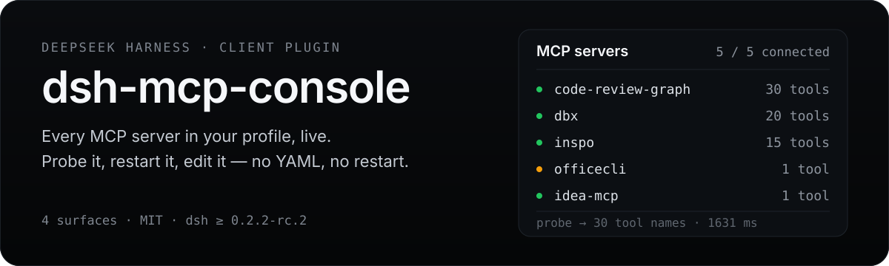
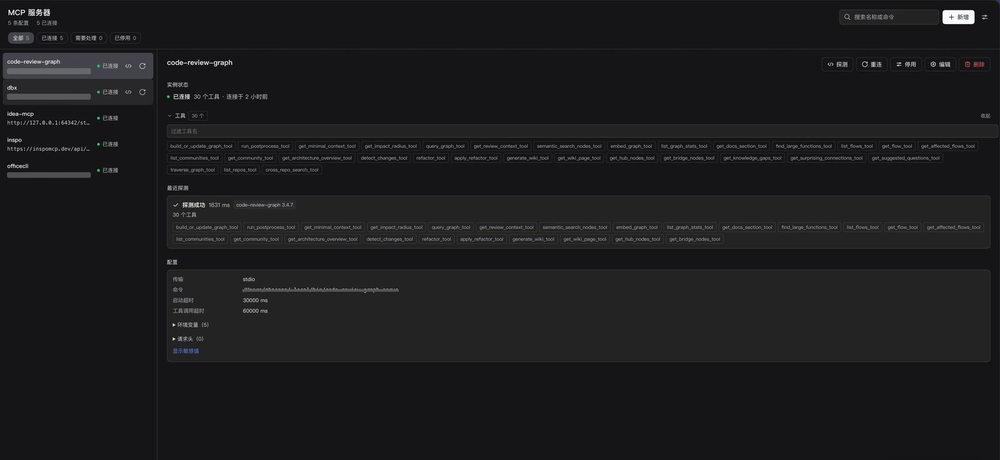
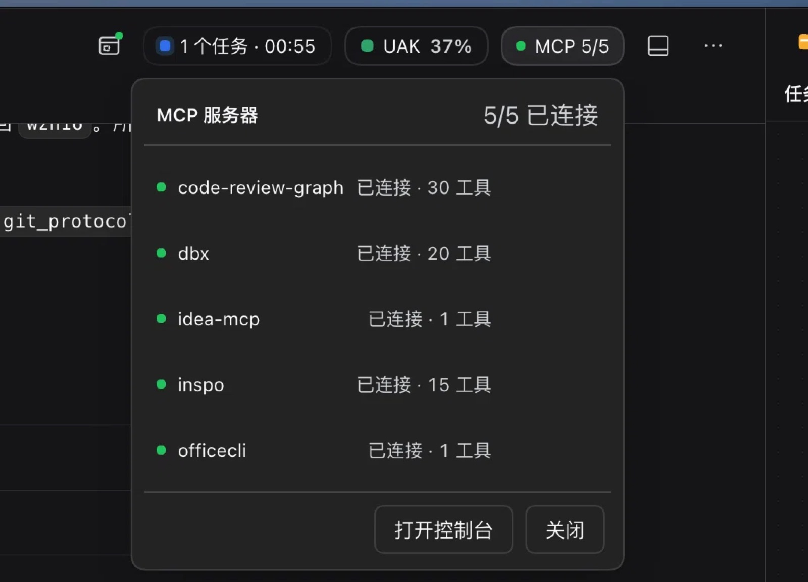
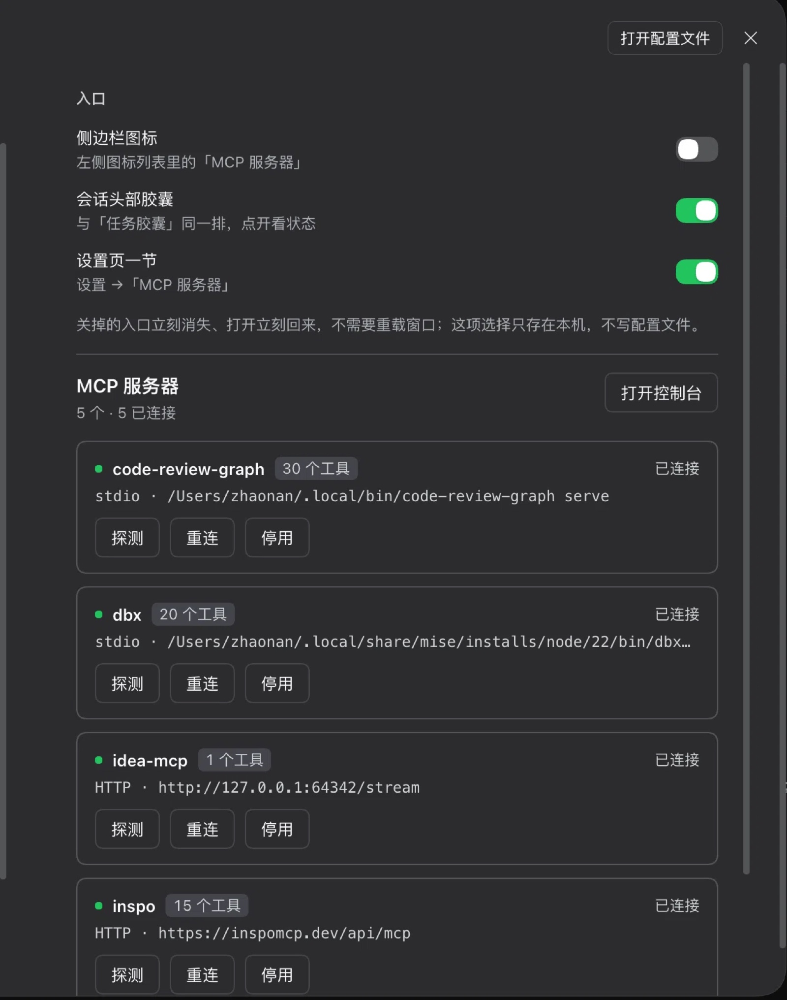
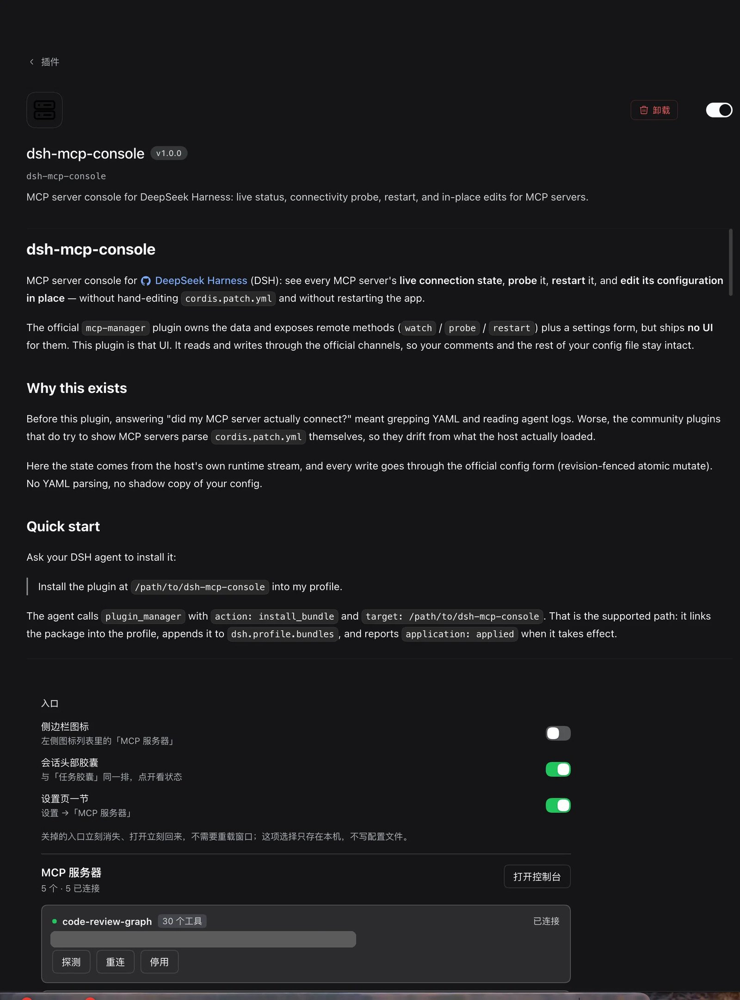
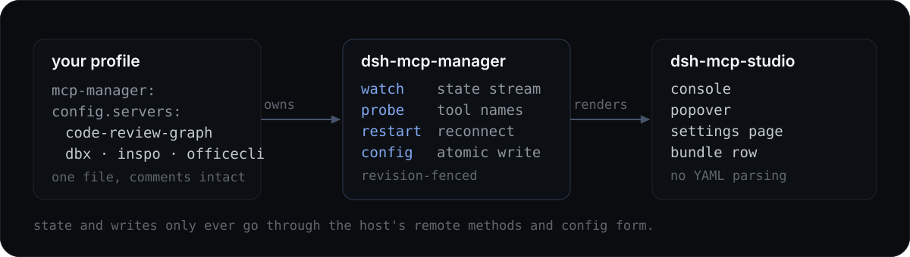

**dsh-mcp-console** 是 DeepSeek Harness 官方 `mcp-manager` 缺的那层界面：实时看每个 MCP 服务器的
**连接状态**、**探测**它的工具清单、**重连**、**就地改配置**——不用手改 `cordis.patch.yml`，也不用重启应用。

界面上的状态全部来自宿主自己的运行时状态流，每一次写入都走官方配置表单（带 revision 围栏的原子 mutate）。
不解析 YAML，不维护配置副本，你写的注释原样留着。

## 控制台



左边是服务器列表（状态、命令、工具数），右边是详情区：实例状态、可展开的工具清单、最近一次探测结果、
解析后的配置。探测、重连、启停、编辑、删除都在这一个界面上。

## 四个界面，四件不同的活

刻意不是同一个组件换三处壳——设置面板本来就窄，会话头部更窄，而工作台需要两栏。

| 界面 | 位置 | 做什么 |
| --- | --- | --- |
| **控制台** | 主面板，从侧边栏图标进 | 两栏工作台：列表、详情、工具清单、新增/编辑抽屉、删除确认 |
| **浮层** | 会话头部的 `MCP n/m` 胶囊 | 只看不动：计数、逐条状态、行内探测/重连、跳进控制台 |
| **设置页** | 设置 → MCP 服务器 | 单列卡片：一条一张卡，外加顶部入口开关 |
| **插件页** | 设置 → 插件 → 本插件 | 同一个设置视图，在哪儿发现插件就在哪儿管服务器 |

<table>
<tr>
<td width="33%"><br><sub><b>浮层</b>——点一下胶囊，不离开会话就能看状态</sub></td>
<td width="33%"><br><sub><b>设置页</b>——一条一张卡，开关在顶部</sub></td>
<td width="33%"><br><sub><b>插件页</b>——同一个视图挂在插件详情下</sub></td>
</tr>
</table>

## 它是怎么工作的



服务器归 `mcp-manager` 所有，它暴露三个远程方法——`watch`（状态流）、`probe`（用一条临时连接列工具名）、
`restart`——外加一个配置表单。这个插件只是这些通道的渲染层。卸掉它什么都不会丢：服务器、状态、
官方设置表单都还在。

## 安装

**在应用里**：设置 → 插件 → 添加插件 → 指向这个仓库，然后重载一次窗口（⌘R / Ctrl+R），客户端包在窗口启动时加载。

**交给 agent**：让它把这个插件装进你的 profile。它会用 `plugin_manager` 的 `action: install_bundle`：
链接包、追加到 `dsh.profile.bundles`，成功时返回 `application: applied`。

**手工**：只用 pnpm **不会**注册 bundle，两步都要做：

```bash
dsh plugin --profile <你的profile> add link:/abs/path/to/dsh-mcp-console
# 再把 "dsh-mcp-console" 加进
#   $DSH_HOME/profiles/<你的profile>/package.json 的 "dsh".profile.bundles
```

## 能做什么

- **探测**：新建一条临时连接、列出工具名、再关掉。不干扰正在跑的实例，停用或失败的服务器也能探。
- **重连**：重连实例并重置重连预算。
- **启用/停用**：整条 entry 重写——停用写 `enabled: false`，启用则删掉该字段。
- **新增/编辑**：写之前先校验——名称规则、两种传输的互斥字段、1–3600000 的整数超时、
  `KEY=VALUE` 与 `Key: Value` 的行形状。
- 其它插件在运行时注册进来的服务器（`configured: false`）在这里**只读**：能探测、能重连，改会被宿主拒绝。
  界面直接标出来，而不是让你点了没反应。

**探测的代价**：宿主没有任何接口能读出「运行中实例」的工具名，所以清单只能靠一条真的临时连接换。
这意味着它和启动那个服务器一样慢（Node 写的 MCP 服务器通常是几秒），也会碰到那个服务器自己的副作用。
所以控制台只显示「最近一次探测 + 时间」，不做轮询。

## 入口与偏好

三个入口都能在 **入口** 区关掉（设置页顶部、控制台里都有）。开关保存在浏览器 `localStorage` 的
`dsh-mcp-console:prefs`，不写配置文件。控制台主面板与插件页那行始终注册着，保证随时能进得来。

## 已知限制

- 界面目前**只有中文**（还没有 locale 包）。
- 只显示**工具名**，没有 schema 与描述——宿主不暴露。
- **没有 JSON 导入导出**；profile 的 patch 文件仍然是唯一事实来源。
- 其它插件运行时注册的服务器不能编辑（宿主限制）。
- 头部胶囊按设计就是浮层：在那儿看状态，改配置去控制台。

## 排错

| 现象 | 处理 |
| --- | --- |
| 侧边栏图标或胶囊不见了 | 在 **入口** 里被关掉了——从「设置 → MCP 服务器」重新打开，或清掉 `dsh-mcp-console:prefs` |
| 控制台说远程方法不可用 | 这个 profile 没启用 `mcp-manager`，或它的 remote 还没挂上（面板会重试并写出原因） |
| 全部显示「状态未知」 | 运行时状态流还没推第一帧；横幅里带着 watch 的错误信息 |
| 编辑被拒 | 宿主拒绝了这次 mutate，通常是并发写入；表单会重新读取，再试一次 |
| 装了但什么都没出现 | 重载一次窗口——客户端包在窗口启动时加载 |

## 权限与数据

读宿主的 MCP 运行时状态流与 `mcp-manager` 配置段；只通过官方配置表单写 `servers.<name>`；
入口开关只占一个 `localStorage` 键。没有遥测，自己不发任何网络请求。

## 兼容性

DSH `>=0.2.2-rc.2 <0.3.0-0`（在 `0.2.2-rc.3` 上实测）。纯客户端，`index.js` 是空的。
注册的槽位：`main`（key `mcp-console`）、`sidebar.panellist`（id `mcp-console`）、
`conversation.session.header.utilities`（id `dsh-mcp-console-pill`）、`settings.section`（id
`mcp-servers`）、`plugins.bundle.config`（key `dsh-mcp-console`）。升级若改了槽位名，控制台照样能打开，
并说明是哪个槽位失败。

## 开发

一个手写的客户端包，没有构建步骤、没有依赖：`client.js`（`window.__ModuleLoader__` 工厂 +
`React.createElement` + 字符串数组形式的 CSS）、`index.js`（宿主模块，刻意留空）、
`cordis.patch.yml`（bundle 插入补丁）。

```bash
# 语法（DSH 自带 Electron，用它的 Node）
ELECTRON_RUN_AS_NODE=1 "/Applications/DeepSeek Harness.app/Contents/MacOS/DeepSeek Harness" --check client.js

# 冒烟测试：43 项断言，不开浏览器、零依赖
ELECTRON_RUN_AS_NODE=1 "/Applications/DeepSeek Harness.app/Contents/MacOS/DeepSeek Harness" test/smoke.mjs
```

冒烟测试（`vm` + 假 React + 假 ctx）覆盖槽位注册、watch 帧、probe/mutate 的调用形状、四个界面与入口开关。

## 路线图

locale 包（英文界面）· 等宿主给出稳定形状后做 JSON 导入导出 · 如果 `mcp-manager` 哪天暴露日志，再加逐服务器日志。

## 许可

MIT，见 [LICENSE](LICENSE)。English README: [README.md](README.md)。
